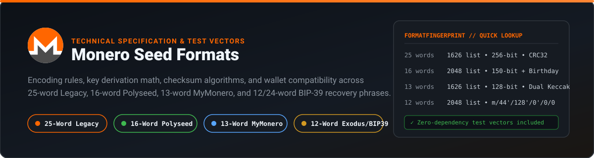
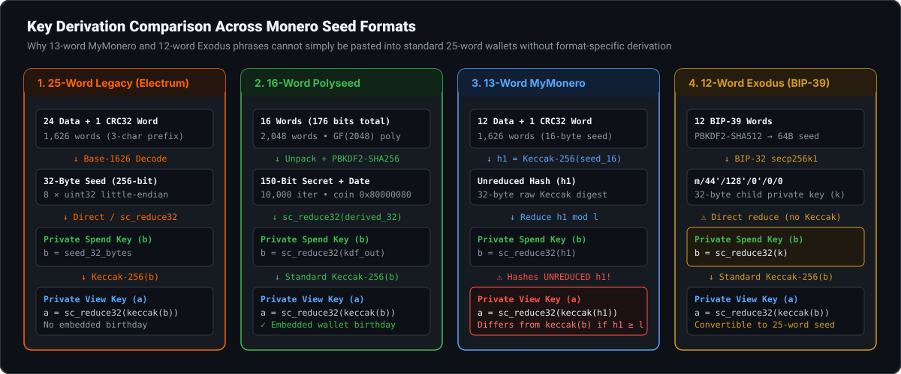

<p align="center">
  
</p>

# Monero Seed Formats

Monero wallets do not all use the same recovery phrase format. Over the last decade, desktop, mobile, web, and hardware wallets have used **25-word**, **16-word**, **13-word**, **12-word**, and **24-word** mnemonics drawn from two different English wordlists (`1,626` words vs. `2,048` words) and several incompatible key-derivation pipelines.

This repository documents the exact binary encoding, checksum rules, scalar reduction math, wallet compatibility matrix, and verified public test vectors for each format, along with zero-dependency Node.js scripts in [`src/`](src/) to test and verify them locally.

---

## Quick Identification by Word Count

| Word Count | Format Name | Wordlist | Prefix Match | Entropy | Embedded Birthday? | Where It Came From |
| :--- | :--- | :--- | :--- | :--- | :--- | :--- |
| **25 words** | **Monero Legacy (Electrum v2)** | Monero (`1,626` words) | First `3` letters | 256-bit (32 B) | No | Monero GUI/CLI, [MonkStash](https://monkstash.com), Cake Wallet (legacy), Feather, Monerujo |
| **16 words** | **Polyseed** | BIP-39 (`2,048` words) | First `4` letters | 150-bit | **Yes** (10-bit month/year) | Feather Wallet, Cake Wallet, Monerujo, Anonero |
| **13 words** | **MyMonero Legacy** | Monero (`1,626` words) | First `3` letters | 128-bit (16 B) | No | MyMonero (discontinued Jan 2026) |
| **12 words** | **Exodus / Multi-Coin BIP-39** | BIP-39 (`2,048` words) | First `4` letters | 128-bit (16 B) | No | Exodus (ended XMR support Aug 2025), Atomic, Trust/Coinomi |
| **24 words** | **Hardware / BIP-39** | BIP-39 (`2,048` words) | First `4` letters | 256-bit (32 B) | No | Ledger, Trezor, Coinomi |

---

## Key Derivation Comparison

<p align="center">
  
</p>

All Monero wallets ultimately need two 32-byte Ed25519 scalars reduced modulo the curve group order $\ell = 2^{252} + 27742317777372353535851937790883648493$:

- **Private spend key** ($b$)
- **Private view key** ($a$)

From $(b, a)$, the wallet computes the public spend key $B = bG$, public view key $A = aG$, and the primary `4...` address. Where seed formats differ is how they turn words into $(b, a)$.

---

## Format Specifications

### 1. 25-Word Monero Legacy (Electrum v2)

The original format introduced in `monero-project/monero` (`src/mnemonics/`).

- **Dictionary:** `1,626` words in English (see [`src/wordlist-monero-en.mjs`](src/wordlist-monero-en.mjs)). Every word has a unique 3-character prefix (`abb` -> `abbey`), so wallets match words by their first 3 letters.
- **Data encoding:** The first `24` words are grouped into 8 triplets. Each triplet `(w1, w2, w3)` encodes one 32-bit little-endian unsigned integer:
  $$x = w_1 + 1626 \cdot ((1626 - w_1 + w_2) \bmod 1626) + 1626^2 \cdot ((1626 - w_2 + w_3) \bmod 1626)$$
  Eight 32-bit integers yield the 32-byte seed.
- **25th checksum word:** Concatenate the first 3 letters of all 24 data words into a 72-character ASCII string, compute standard IEEE 802.3 `CRC-32`, and take `index = crc32 % 24`. The 25th word is a copy of `words[index]`.
- **Key derivation:**
  - `private_spend_key` ($b$) = the 32-byte seed directly (already reduced modulo $\ell$ when generated)
  - `private_view_key` ($a$) = `sc_reduce32(keccak256(b))` (using original pre-NIST Keccak-256 with `0x01` domain padding, **not** FIPS-202 SHA3-256).
- **Restore height:** Not stored in the phrase. When restoring an older 25-word seed, pair it with the block height or date the wallet was created (you can look up the exact block for any date with the [MonkStash Restore Height Calculator](https://monkstash.com/tools/monero-restore-height-calculator)).

---

### 2. 16-Word Polyseed

Designed by `tevador` (`tevador/polyseed`) to shorten the phrase, include a built-in wallet birthday, and detect word transpositions.

- **Dictionary:** Standard `2,048`-word BIP-39 wordlist (11 bits per word = 176 bits across 16 words).
- **Bit layout (176 bits total):**
  - `150` bits: secret seed material
  - `10` bits: wallet creation timestamp (month resolution starting from November 2021, spanning ~85 years)
  - `5` bits: feature flags (including passphrase encryption bit)
  - `11` bits: Reed-Solomon polynomial checksum over $\text{GF}(2048)$
- **Key derivation:**
  - Derive a 32-byte key via `PBKDF2-HMAC-SHA256` with `10,000` iterations, domain-separated for Monero (`coin = 0x80000080`).
  - `private_spend_key` ($b$) = `sc_reduce32(pbkdf2_output)`
  - `private_view_key` ($a$) = `sc_reduce32(keccak256(b))`

---

### 3. 13-Word MyMonero Legacy

Used by the MyMonero light wallet until its shutdown in January 2026.

- **Dictionary & Checksum:** Uses the same `1,626`-word Monero dictionary and 3-words-per-4-bytes math as the 25-word format, but with only `12` data words (4 triplets = 16 bytes / 128 bits) plus a `13th` CRC-32 checksum word (`crc32(prefixes_12) % 12`).
- **Why standard wallets fail to import it:**
  MyMonero expands the 16-byte seed with Keccak-256, but derives the view key from the **unreduced** first hash:
  ```text
  h1                = keccak256(seed_16_bytes)
  private_spend_key = sc_reduce32(h1)
  private_view_key  = sc_reduce32(keccak256(h1))   // <-- hashes h1 BEFORE sc_reduce32!
  ```
  If you convert `private_spend_key` into a 25-word seed and paste it into a standard wallet, the standard wallet computes `sc_reduce32(keccak256(private_spend_key))`. Whenever the 256-bit integer `h1` is greater than or equal to the Ed25519 group order $\ell \approx 2^{252}$, `sc_reduce32(h1) != h1`, so a 25-word seed derived from the spend key produces the **wrong view key and wrong address**.
- **How to restore:** Use a wallet that implements native 13-word MyMonero key derivation (such as the [MonkStash MyMonero Seed Restore guide](https://monkstash.com/restore-mymonero-seed)), or extract the raw 32-byte spend key, view key, and primary address and import via keys.

---

### 4. 12-Word Exodus & 24-Word Hardware BIP-39

Multi-coin software wallets (like Exodus, which ended Monero support in August 2025) and hardware wallets (like Ledger) use a single 12-word or 24-word BIP-39 recovery phrase across all coins.

- **BIP-39 to BIP-32 step:**
  1. Convert the 12 or 24 BIP-39 words to a 64-byte master seed via `PBKDF2-HMAC-SHA512` (`2048` iterations, salt `"mnemonic" + passphrase`).
  2. Derive the `secp256k1` child private key $k$ at SLIP-0044 Monero path `m/44'/128'/0'/0/0` (where `128` / `0x80000080` is Monero's registered coin type).
- **Critical divergence at step 3 (Exodus vs. Ledger/Coinomi):**
  - **Exodus style:** Reduces the 32-byte BIP-32 private key directly without hashing:
    ```text
    private_spend_key = sc_reduce32(k)
    private_view_key  = sc_reduce32(keccak256(private_spend_key))
    ```
    Because the view key is derived from `private_spend_key` using standard Monero rules, an Exodus 12-word phrase **can** be deterministically converted into an exact 25-word Monero Legacy seed.
  - **Ledger / Coinomi style:** Hashes the derived node key with Keccak-256 before `sc_reduce32`, yielding a completely different Monero address from the exact same 12 or 24 words.
- **How to restore an Exodus 12-word phrase:** You can restore a 12-word Exodus phrase directly in the browser or desktop app (see the [MonkStash Exodus Monero Recovery guide](https://monkstash.com/exodus-monero) or [MonkStash Wallet Restore](https://monkstash.com/restore-monero-wallet)), or select `BIP39 (Exodus style)` in Cake Wallet.

---

## Wallet Compatibility Matrix

| Wallet | 25-Word Legacy | 16-Word Polyseed | 13-Word MyMonero | 12-Word Exodus (BIP-39) | Raw Spend + View Keys |
| :--- | :---: | :---: | :---: | :---: | :---: |
| **[MonkStash](https://monkstash.com)** | Yes | — | **Yes (Direct)** | **Yes (Direct)** | — |
| **Monero GUI / CLI** | Yes | No | No | No | Yes (`--generate-from-keys`) |
| **Feather Wallet** | Yes | Yes (Default) | Via keys | No ( converts standard BIP-39 only) | Yes |
| **Cake Wallet** | Yes | Yes | Yes | Yes (`Exodus style` option) | Yes |
| **Monerujo** | Yes | Yes | No | No | Yes |

For a side-by-side overview of how seed phrases work when creating or backing up a wallet, see the [MonkStash Monero Seed Phrase Overview](https://monkstash.com/monero-seed-phrase).

---

## Verified Public Test Vectors

All vectors below are stored in [`data/seed-formats.json`](data/seed-formats.json) and verified automatically by [`scripts/validate.mjs`](scripts/validate.mjs). **Never send real funds to public test vectors.**

### 13-Word MyMonero Vectors

Source: [`moneroexamples/mymonero-keys`](https://github.com/moneroexamples/mymonero-keys)

| Field | Vector 1 | Vector 2 |
| :--- | :--- | :--- |
| **13-Word Phrase** | `slid otherwise jeers lurk swung tawny zodiac tusks twang cajun swagger peaches tawny` | `nearby hover hiker renting giddy purged chrome paddles point tsunami hoax pledge point` |
| **16-Byte Seed (Hex)** | `5878efd0a6d45b0374b49c000da07cd2` | `fbdf0efd70ff3c5a321e0f0969041948` |
| **Private Spend Key** | `804f08b84507fb0610910d04ae517c07ae2f38f9330e42e86a50286db16ad60e` | `bef8b944fdc3eb086b9f0ee4e79aa30ce1510bfd0e45e86891264771de588404` |
| **Private View Key** | `dbb024c981cf7dc797593713f5f426c3b1cad50542c0814d4786e12e768be504` | `8952f17e4378c74fcd99ed6c70e799db60a601edf2685407087cc8c06d4db808` |
| **Primary Address** | `48VWHdLTEpE5dqa5VpAy5xgQWBHZARiGmEmojNLqD4ef1FAzkPxCe9JXUYwCShRR5XNMGnyusrnkmMWr2HMdfDRx2vsrG7c` | `43oVy226ybWYYA93SExWoLR1tznhhaXRqi5pLtYWhcM3212LriHRkLecvj6zoehqkLRbN9P18LDBGPhP9fHHY7Ar1qi9QDM` |

### 12-Word Exodus (BIP-39) to 25-Word Monero Seed Vectors

Source: Cake Wallet `cw_monero/test/bip39_seed_test.dart` (`Exodus Style bip39`)

| 12-Word BIP-39 Phrase | BIP-32 Path | Equivalent 25-Word Monero Legacy Seed |
| :--- | :--- | :--- |
| `meadow tip best belt boss eyebrow control affair eternal piece very shiver` | `m/44'/128'/0'/0/0` | `tasked eight afraid laboratory tail feline rift reinvest vane cafe bailed foggy dormant paper jigsaw king hazard suture king dapper dummy jolted dating dwindling king` |
| `meadow tip best belt boss eyebrow control affair eternal piece very shiver` | `m/44'/128'/1'/0/0` | `palace pairing axes mohawk rekindle excess awful juvenile shipped talent nibs efficient dapper biggest swung fight pact innocent emerge issued titans affair nearby noises emerge` |
| `color ranch color remove subway public water embrace before begin liberty fault` | `m/44'/128'/0'/0/0` | `somewhere problems gauze gigantic intended foxes upcoming saved waffle pipeline lurk bogeys empty wipeout abbey italics novelty tucks rafts elite lunar obnoxious awful bugs elite` |

---

## Local Verification & CLI Usage

This repository uses zero external `npm` dependencies. All Keccak-256 (`0x01` padding), `sc_reduce32`, CRC-32, and base-1626 word codecs are implemented in plain JavaScript in [`src/`](src/).

### Run the test vector suite

```bash
node scripts/validate.mjs
```

### Inspect a public test vector offline

```bash
node scripts/inspect-format.mjs "slid otherwise jeers lurk swung tawny zodiac tusks twang cajun swagger peaches tawny"
```

---

## License

Released under the [MIT License](LICENSE).
